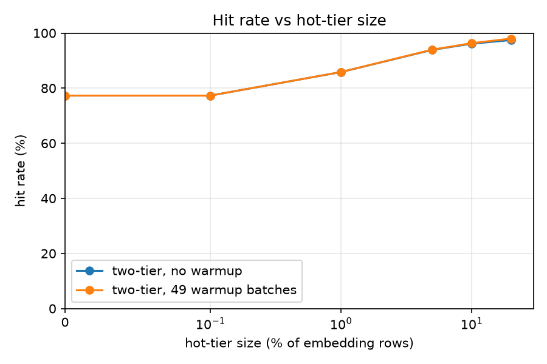
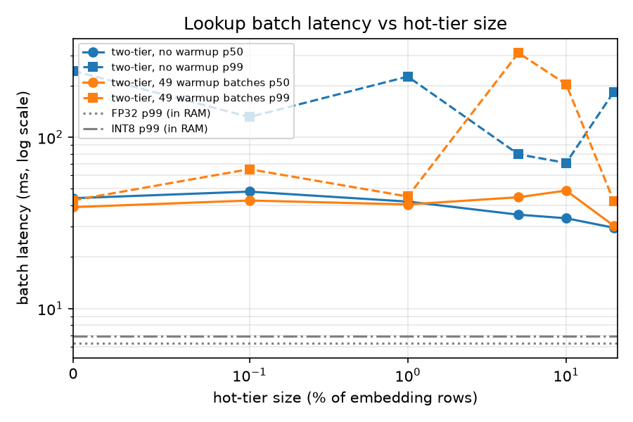
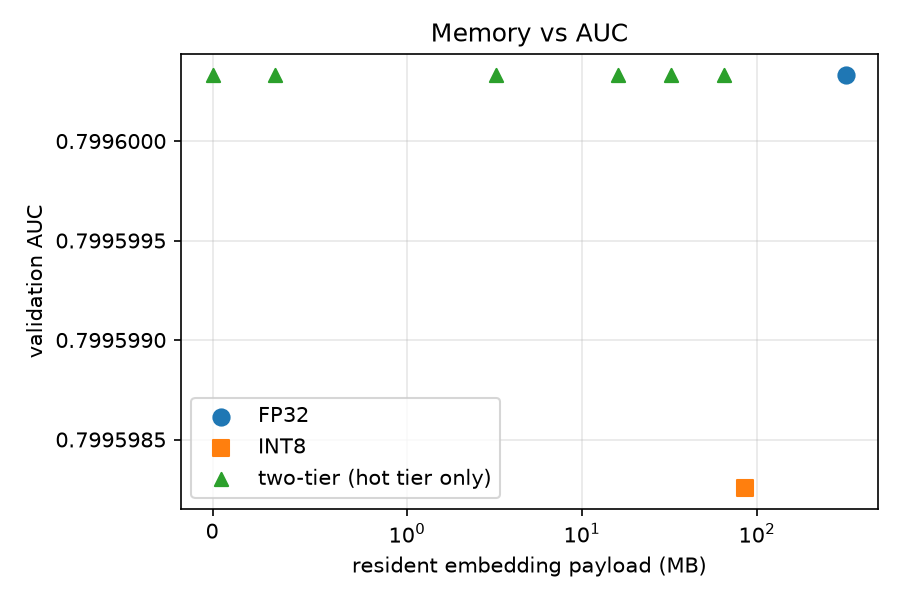

# EmbedServe

A two-tier, quantized embedding store for serving DLRM-style recommendation models.

In a DLRM (Deep Learning Recommendation Model), the MLPs are small and the embedding tables are
huge, so serving is limited by memory rather than compute. Lookups are also highly skewed: a small
share of IDs receives most of the traffic. EmbedServe keeps the hot rows in a small in-memory LRU
tier, stores the long tail in RocksDB on disk, and supports INT8 tables with a per-row scale. A
fixed, trained DLRM can be served from any of these stores, so you can measure exactly what each
one costs in memory, latency and accuracy.

**Highlights** (Criteo, 1.26M embedding rows, 1M validation rows):

- **INT8 tables** use 26.6% of the FP32 memory and change AUC by 2×10⁻⁶.
- **Two-tier serving** is exact (same AUC as FP32) and reaches a 94% hit rate with 5% of rows
  in memory (16 MB instead of 322 MB).
- **Python-only lookups are the current bottleneck:** two-tier lookups are 7–12× slower than
  FP32 in RAM, whatever the hit rate. See [Results](#results).

## How it works

```
batch of IDs ─► TierManager
                 ├─ hot tier: in-memory LRU of FP32 rows
                 └─ cold tier: RocksDB on disk, one batched multi-get per field for all misses
```

- **Stores** (`embedserve/serving.py`) share one `lookup(ids) -> (batch, fields, dim)` interface:
  - `FP32Store`: every table in RAM.
  - `INT8Store`: INT8 tables with one FP32 scale per row, dequantized on lookup.
  - `TwoTierStore`: an LRU hot tier backed by RocksDB.
- **Model** (`embedserve/model.py`): a standard DLRM. A bottom MLP (13→512→256→64) processes
  the dense features. There are 26 embedding tables of dimension 64. The pairwise dot products
  of all 27 vectors (351) plus the bottom output feed a top MLP (415→512→256→1).
  `DLRM.forward_from_embeddings` accepts rows fetched from any store, so the same trained
  weights are evaluated against every backend.
- **Evaluation** (`embedserve/evaluation.py`): measures AUC, log loss, embedding memory, hit
  rate and p50/p99 batch latency. See [docs/evaluation.md](docs/evaluation.md) for exact
  metric definitions.

## Quickstart

### 1. Install

Requires Python 3.10+. Developed on Python 3.14, macOS, CPU only.

```bash
git clone https://github.com/SuyashManiyar/EmbedServe.git && cd EmbedServe
python3 -m venv .venv && source .venv/bin/activate
pip install -e ".[dev,model,plots]"
pytest
```

| Extra | Adds | Needed for |
|---|---|---|
| `dev` | pytest | running the tests |
| `model` | PyTorch, scikit-learn | training and evaluation |
| `plots` | matplotlib | plotting results |

The tests use synthetic data and don't need the dataset.

### 2. Get the data

EmbedServe uses the first rows of the train and validation splits of
[reczoo/Criteo_x1](https://huggingface.co/datasets/reczoo/Criteo_x1). That dataset is a
preprocessed mirror of the
[Criteo Display Advertising Challenge](https://www.kaggle.com/c/criteo-display-ad-challenge)
data: 45.8M rows, already shuffled and split 7:2:1. Building the subset needs about 3 GB of
temporary disk:

```bash
mkdir -p data && curl -L -C - -o data/Criteo_x1.zip https://huggingface.co/datasets/reczoo/Criteo_x1/resolve/main/Criteo_x1.zip
unzip -p data/Criteo_x1.zip train.csv | head -n 5000001 > data/train_5M.csv
unzip -p data/Criteo_x1.zip valid.csv | head -n 1000001 > data/valid_1M.csv
rm data/Criteo_x1.zip
```

| File | Rows | Size | Use |
|---|---|---|---|
| `data/train_5M.csv` | 5,000,000 | 1.2 GB | training, vocabulary, skew statistics |
| `data/valid_1M.csv` | 1,000,000 | 237 MB | held-out evaluation |

Each CSV has the header `label,I1..I13,C1..C26`:

- The 13 dense features (`I*`) are min-max scaled to [0, 1].
- The 26 categorical features (`C*`) are integer IDs in one ID space shared across fields.
- The click rate is about 25%.

`data/` is gitignored.

### 3. Encode the data (~40 s)

```bash
python scripts/prepare_data.py --train data/train_5M.csv --valid data/valid_1M.csv --min-count 1 --dim 64
```

This writes `data/processed/{train,valid,vocab}.npz` and prints lookup-skew statistics. Each
field gets its own table with rows numbered 1..V. Row 0 is shared by rare and unseen IDs.
`--min-count 1` keeps every ID seen in training.

### 4. Train the model (~5 min on an M1)

```bash
python scripts/train.py
```

This writes three files to `data/model/`:

- `dlrm.pt`: the model weights.
- `embeddings.npz`: one FP32 array per table.
- `metrics.json`: training settings and validation metrics.

For a quick check, add `--train-rows 200000 --valid-rows 100000` (~10 s, AUC ≈ 0.77).

Training is seeded (`--seed 0`), but floating-point results can differ slightly across
machines. Compare stores using runs from a single checkpoint.

### 5. Evaluate

```bash
python scripts/evaluate.py --rows 10000
```

This serves the checkpoint through the FP32, INT8 and two-tier stores on the first 10,000
validation rows. The report goes to `experiments/results/evaluation.json`.

- Omit `--rows` to use the full validation file.
- Pass several values to `--hot-capacities` to sweep cache sizes.

### 6. Reproduce the results

```bash
python scripts/evaluate.py --hot-capacities 0 1257 12574 62868 125736 251472 \
  --out experiments/results/full-warmup0.json
python scripts/evaluate.py --modes two-tier --warmup-batches 49 \
  --hot-capacities 0 1257 12574 62868 125736 251472 \
  --out experiments/results/full-warmup49.json
python scripts/plot_results.py experiments/results/full-warmup0.json experiments/results/full-warmup49.json
```

Each two-tier run builds a fresh RocksDB database before timing starts. The plots and a
Markdown table are written to `experiments/plots/`.

## Results

**Setup:**

- **Data:** 5M training rows and 1M validation rows.
- **Embeddings:** 1,257,358 rows over 26 tables (the largest has ~224K rows, the smallest 4),
  at dimension 64.
- **Model:** FP32 baseline at validation AUC 0.7996 and log loss 0.4473. Trained for one
  epoch with batch size 2048 and Adam / SparseAdam at lr 1e-3. Training took 318 s on an M1
  with 4 threads and peaked at ~1.7 GB RAM.
- **Evaluation:** all 1M validation rows, batch size 2048 (489 batches), 4 threads, one
  checkpoint, on an M1 MacBook with 8 GB RAM.

### Access skew

All tables are treated as one row space, as the shared hot tier sees them. Each row of the
table below gives the share of training lookups served by an ideal hot tier holding the most
frequent rows. That is an upper bound on what an LRU can achieve.

| Hottest share of rows | Rows | Share of lookups |
|---|---|---|
| 0.1% | 1,257 | 72.3% |
| 1% | 12,574 | 88.4% |
| 5% | 62,868 | 95.4% |
| 10% | 125,736 | 97.1% |

### Store comparison

How to read the table:

- Hot-tier sizes are shares of the 1,257,358 embedding rows.
- Payload is the resident embedding arrays only (MB = 10⁶ bytes). The two-tier figures exclude
  RocksDB's own memory.
- The full table, with log loss and end-to-end latency, is in
  [experiments/plots/results.md](experiments/plots/results.md).

| Store | Hot tier | Payload | AUC | Hit rate (no warmup / 49 warmup) | Lookup p50 / p99 ms (49 warmup) |
|---|---|---|---|---|---|
| FP32 in RAM | all | 321.9 MB | 0.799600 | — | 4.0 / 6.3 (no warmup) |
| INT8 in RAM | all | 85.5 MB (26.6%) | 0.799598 | — | 5.1 / 6.9 (no warmup) |
| Two-tier | 0 | 0 MB | 0.799600 | 77.3% / 77.3% | 39.1 / 42.9 |
| Two-tier | 0.1% | 0.3 MB | 0.799600 | 77.3% / 77.3% | 42.7 / 65.1 |
| Two-tier | 1% | 3.2 MB | 0.799600 | 85.8% / 85.9% | 40.5 / 45.1 |
| Two-tier | 5% | 16.1 MB | 0.799600 | 93.9% / 94.0% | 44.7 / 310.7 |
| Two-tier | 10% | 32.2 MB | 0.799600 | 96.1% / 96.3% | 48.8 / 203.6 |
| Two-tier | 20% | 64.4 MB | 0.799600 | 97.4% / 98.0% | 30.4 / 42.4 |





### Findings

- **INT8 is nearly free in accuracy.** It cuts embedding memory to 26.6% of FP32 and changes
  AUC by 2×10⁻⁶. Dequantizing on lookup adds about 1 ms per batch.
- **Two-tier serving is exact.** AUC matches FP32 at every hot-tier size.
- **Much of the hit rate comes from repeated IDs within a batch.** `TierManager` counts a
  repeated ID in the same field batch as a hit, so the hit rate is 77.3% even with no hot tier.
  The LRU adds to that:

  | Hot tier | Hit rate |
  |---|---|
  | 0.1% of rows | no change (77.3%) |
  | 1% | 86% |
  | 5% | 94% |
  | 20% | 97–98% |

  These hit rates are measured differently from the access-skew table, which counts every
  lookup separately, so the two tables aren't directly comparable.
- **Warmup barely matters.** The LRU fills early in a 489-batch pass, so 49 warmup batches
  raise hit rates by at most 0.6 points.
- **Two-tier lookups are 7–12× slower than FP32 at the median, whatever the hit rate.** The
  p50 stays between 30 and 49 ms from 0% to 20% of rows in the hot tier. The cost is mostly
  the Python loop in `TierManager.lookup`, which handles each of the 2,048 × 26 IDs in a batch
  one at a time. The RocksDB reads are a smaller part. A vectorized or native hot tier is
  needed before the cache pays off in latency.
- **p99 is noisy.** Each configuration was run once, and the slowest batches vary between
  runs. For example, the 5% hot tier's p99 was 79 ms without warmup and 311 ms with it. Treat
  p99 differences under about 3× as noise.

## Roadmap

- Vectorized hot-tier lookup, then a C++ hot tier via pybind11, compared against the Python one
- Store INT8 rows in the tiers directly instead of keeping FP32 rows in the LRU
- Eviction policy comparison: LRU vs frequency-based
- Repeated runs with confidence intervals for tail latency
- A serving API with dynamic batching
- Further directions:
  - GPU memory as a third tier
  - INT4 and mixed precision
  - Comparison with FBGEMM and TorchRec
  - Triton kernels
  - Pruning cold rows

## Project layout

```
embedserve/
  tiers.py          Hot tier, cold tiers (in-memory and RocksDB), TierManager
  quantize.py       FP32 → INT8 quantizer with a per-row scale
  serving.py        FP32, INT8 and two-tier embedding stores
  evaluation.py     Accuracy and batch latency measurements
  data.py           Criteo CSV loader, per-table vocabulary, access-skew stats
  model.py          DLRM that can run from embeddings fetched by any store
scripts/
  prepare_data.py   Encode Criteo subsets into data/processed/*.npz
  train.py          Train the DLRM; saves weights and FP32 tables to data/model/
  evaluate.py       Evaluate a checkpoint across embedding stores
  plot_results.py   Plots and a Markdown table from evaluate.py reports
docs/               Evaluation commands and metric definitions
experiments/plots/  Plots and results table (raw reports go to the ignored experiments/results/)
tests/              pytest suite on synthetic data
data/               Gitignored: CSVs, processed arrays, trained model
```

## Contributing

Issues and pull requests are welcome.

- Open pull requests against `main`.
- Run `pytest` before submitting, and add tests for new code.
- Keep data, models and raw results out of git.
- Put reusable code in `embedserve/` and entry points in `scripts/`. Scripts take paths and
  sizes as flags.
- When you report a number, include the data subset, checkpoint and settings that produced it.

## License

The code is released under the [MIT License](LICENSE).

## Data

The Criteo dataset is distributed by Criteo under its own terms; see the
[Kaggle competition page](https://www.kaggle.com/c/criteo-display-ad-challenge) and the
[Hugging Face mirror](https://huggingface.co/datasets/reczoo/Criteo_x1). This repository
contains no Criteo data.
