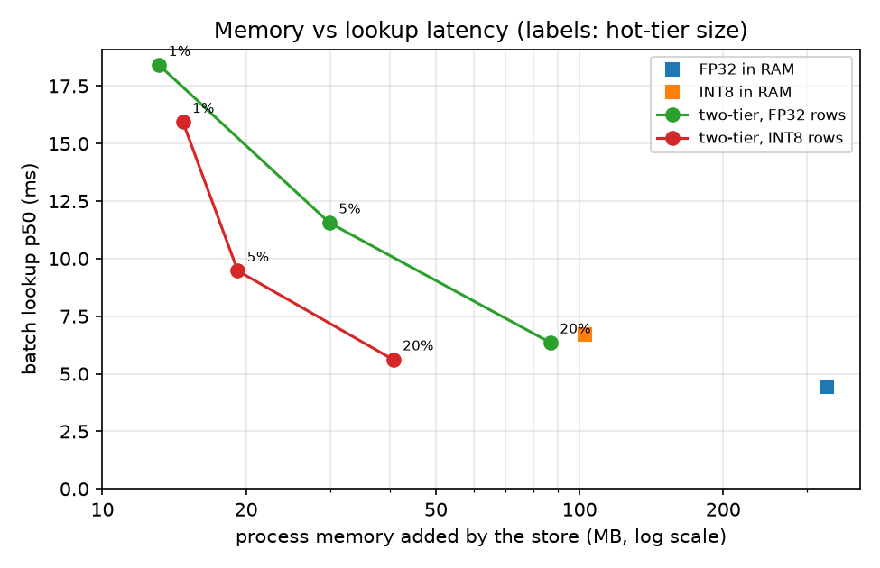
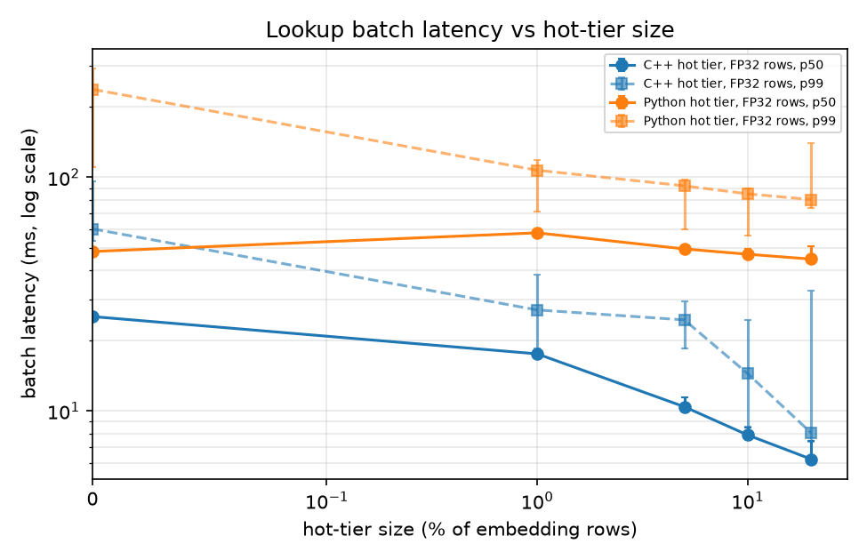
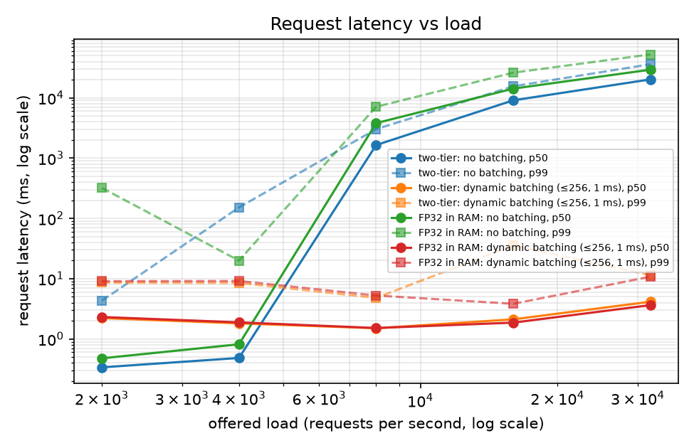

# EmbedServe

A two-tier, quantized embedding store and request server for DLRM-style recommendation models.

In a DLRM (Deep Learning Recommendation Model), the MLPs are small and the embedding tables are
huge, so serving is limited by memory rather than compute. Lookups are also highly skewed: a small
share of IDs receives most of the traffic. EmbedServe keeps the hot rows in a small in-memory LRU
tier written in C++, stores the long tail in RocksDB on disk, and can hold rows in both tiers as
INT8 with a per-row scale. A dynamic batcher groups single requests so the store and model are
called once per batch. A fixed, trained DLRM can be served from any store, so you can measure
exactly what each one costs in memory, latency, throughput and accuracy.

**Highlights** (Criteo, 1.26M embedding rows, one M1 laptop; details in [Results](#results)):

- **8× less memory at the same accuracy.** Serving from INT8 rows with a 20% hot tier adds 41 MB
  to the process, against 329 MB for FP32 tables in RAM. AUC changes by 2×10⁻⁶.
- **Close to in-RAM latency.** That store looks up a batch of 2,048 requests in 5.6 ms (p50)
  against 4.4 ms for FP32 in RAM.
- **5.5× more requests per second with dynamic batching.** Single requests saturate the server
  at about 5,800 req/s. With batching it sustained 31,700 req/s with a p50 of 4.2 ms and a p99
  of 11 ms.
- **The C++ hot tier is 7.2× faster than the Python one** at p50 for a 20% hot tier, and 10× at
  p99.

## How it works

```
requests ─► DynamicBatcher ─► TierManager ─► DLRM MLPs
                                ├─ hot tier: in-memory LRU (C++), FP32 or INT8 rows
                                └─ cold tier: RocksDB, one multi-get per batch for all misses
```

- **Stores** (`embedserve/serving.py`) share one `lookup(ids) -> (batch, fields, dim)` interface:
  - `FP32Store`: every table in RAM.
  - `INT8Store`: INT8 tables with one FP32 scale per row, dequantized on lookup.
  - `TwoTierStore`: an LRU hot tier backed by RocksDB. One pass covers every field of a
    batch: hot hits are copied out, each distinct missing row is fetched once, and all misses
    go to RocksDB in a single multi-get.
- **Row formats** (`embedserve/tiers.py`): both tiers hold rows as fixed-width records, either
  FP32 (256 bytes at dimension 64) or INT8 values plus an FP32 scale (68 bytes). INT8 rows are
  dequantized as they are read and match `INT8Store` exactly.
- **Hot tier** (`embedserve/_hot.cpp`, `embedserve/tiers.py`): two interchangeable LRU
  implementations that return identical rows and statistics.
  - `cpp`: a pybind11 extension. It stores records in one contiguous buffer, with an
    open-addressing hash index and an intrusive LRU list, and runs the per-ID pass of a
    whole batch in C++ without holding the GIL. Cold records come back from the fetch as
    bytes; C++ decodes them straight into the output rows that missed and copies each
    found row into the hot tier once.
  - `python`: an `OrderedDict`, one Python step per ID. Kept as the reference and baseline.
- **Cold tier**: RocksDB with compression off, because embedding rows don't compress. SST
  files are read through mmap by default, which is faster but counts the mapped file pages in
  the process's resident memory; reads can go through RocksDB's block cache instead.
- **Dynamic batching** (`embedserve/batching.py`): callers submit one request at a time. A
  worker thread takes everything already queued, waits up to `max_wait_ms` for more, and
  serves up to `max_batch_size` requests with one lookup and one forward pass. A request that
  fails is retried alone, so it doesn't fail the rest of its batch.
- **Export** (`embedserve/export.py`): writes the MLP weights, FP32 and INT8 arrays and both
  RocksDB tiers to one directory. A serving process opens only the store it uses and never
  loads the full FP32 tables.
- **Model** (`embedserve/model.py`): a standard DLRM. A bottom MLP (13→512→256→64) processes
  the dense features. There are 26 embedding tables of dimension 64. The pairwise dot products
  of all 27 vectors (351) plus the bottom output feed a top MLP (415→512→256→1).
  `DLRM.forward_from_embeddings` accepts rows fetched from any store.
- **Measurement** (`embedserve/evaluation.py`, `scripts/`): AUC, log loss, hit rate, batch and
  single-request latency, process memory, and request throughput under load. See
  [docs/evaluation.md](docs/evaluation.md) for exact definitions.

## Quickstart

### 1. Install

Requires Python 3.10+ and a C++17 compiler. Developed on Python 3.14, macOS, CPU only.

```bash
git clone https://github.com/SuyashManiyar/EmbedServe.git && cd EmbedServe
python3 -m venv .venv && source .venv/bin/activate
pip install -e ".[dev,model,plots]"
pytest
```

| Extra | Adds | Needed for |
|---|---|---|
| `dev` | pytest | running the tests |
| `model` | PyTorch, scikit-learn, psutil | training, evaluation and benchmarks |
| `plots` | matplotlib | plotting results |

The tests use synthetic data and don't need the dataset.

`pip install -e .` also compiles the C++ hot tier (`embedserve/_hot.cpp`). If you edit the C++
source, run the install again to rebuild it.

### 2. Get the data

EmbedServe uses the first rows of the train and validation splits of
[reczoo/Criteo_x1](https://huggingface.co/datasets/reczoo/Criteo_x1). That dataset is a
preprocessed mirror of the
[Criteo Display Advertising Challenge](https://www.kaggle.com/c/criteo-display-ad-challenge)
data: 45.8M rows, already shuffled and split 7:2:1. Building the subset needs about 3 GB of
temporary disk:

```bash
mkdir -p data && curl -L -C - -o data/Criteo_x1.zip https://huggingface.co/datasets/reczoo/Criteo_x1/resolve/main/Criteo_x1.zip
unzip -p data/Criteo_x1.zip train.csv | head -n 5000001 > data/train_5M.csv
unzip -p data/Criteo_x1.zip valid.csv | head -n 1000001 > data/valid_1M.csv
rm data/Criteo_x1.zip
```

| File | Rows | Size | Use |
|---|---|---|---|
| `data/train_5M.csv` | 5,000,000 | 1.2 GB | training, vocabulary, skew statistics |
| `data/valid_1M.csv` | 1,000,000 | 237 MB | held-out evaluation |

Each CSV has the header `label,I1..I13,C1..C26`:

- The 13 dense features (`I*`) are min-max scaled to [0, 1].
- The 26 categorical features (`C*`) are integer IDs in one ID space shared across fields.
- The click rate is about 25%.

`data/` is gitignored.

### 3. Encode the data (~40 s)

```bash
python scripts/prepare_data.py --train data/train_5M.csv --valid data/valid_1M.csv --min-count 1 --dim 64
```

This writes `data/processed/{train,valid,vocab}.npz` and prints lookup-skew statistics. Each
field gets its own table with rows numbered 1..V. Row 0 is shared by rare and unseen IDs.
`--min-count 1` keeps every ID seen in training.

### 4. Train the model (~5 min on an M1)

```bash
python scripts/train.py
```

This writes three files to `data/model/`:

- `dlrm.pt`: the model weights.
- `embeddings.npz`: one FP32 array per table.
- `metrics.json`: training settings and validation metrics.

For a quick check, add `--train-rows 200000 --valid-rows 100000` (~10 s, AUC ≈ 0.77).

Training is seeded (`--seed 0`), but floating-point results can differ slightly across
machines. Compare stores using runs from a single checkpoint.

### 5. Export a serving directory

```bash
python scripts/export_store.py
```

This writes `data/store/` (about 855 MB): the MLP weights without embedding tables, the FP32
and INT8 arrays, and RocksDB databases of FP32 and INT8 rows. The benchmarks below open stores
from it.

### 6. Evaluate accuracy and latency

```bash
python scripts/evaluate.py --store data/store --rows 10000
```

This serves the checkpoint through the FP32, INT8 and two-tier stores on the first 10,000
validation rows and reports AUC, log loss, hit rate and batch latency. The report goes to
`experiments/results/evaluation.json`.

- Omit `--rows` to use the full validation file.
- `--hot-capacities`, `--hot-backends python cpp` and `--row-formats fp32 int8` each take
  several values and run every combination.
- `--repeats N` repeats every configuration N times. Repeats are interleaved, so slow
  periods on the machine affect all configurations alike.
- `--batch-size 1` measures single requests.
- Without `--store`, runs load `data/model/dlrm.pt` and build temporary RocksDB databases.

### 7. Measure memory and throughput

```bash
python scripts/measure_memory.py --no-mmap --repeats 2
python scripts/benchmark_serving.py --repeats 3
```

`measure_memory.py` serves each store in a fresh process and records its peak memory.
`benchmark_serving.py` sends single requests at fixed rates, with and without dynamic
batching, and records achieved throughput and request latency.

### 8. Reproduce the results

```bash
CAPS="0 12574 62868 125736 251472"
R=experiments/results
python scripts/evaluate.py --store data/store --hot-backends cpp --row-formats fp32 int8 \
  --warmup-batches 49 --repeats 3 --hot-capacities $CAPS --out $R/formats.json
python scripts/evaluate.py --store data/store --modes two-tier --hot-backends python cpp \
  --warmup-batches 49 --repeats 3 --hot-capacities $CAPS --out $R/backends.json
python scripts/evaluate.py --store data/store --hot-backends cpp --row-formats fp32 int8 \
  --hot-capacities 62868 251472 --batch-size 1 --rows 60000 --warmup-batches 20000 \
  --repeats 2 --out $R/single-request.json
python scripts/measure_memory.py --no-mmap --repeats 2 --out $R/memory.json
python scripts/benchmark_serving.py --rates 2000 4000 8000 16000 32000 --duration 8 \
  --repeats 3 --out $R/serving.json
python scripts/benchmark_serving.py --mode fp32 --rates 2000 4000 8000 16000 32000 \
  --duration 8 --out $R/serving-fp32.json
python scripts/plot_results.py $R/formats.json --memory $R/memory.json \
  --single-request $R/single-request.json --serving $R/serving.json $R/serving-fp32.json
python scripts/plot_results.py $R/backends.json --out-dir experiments/plots/backends
```

In zsh, write `${=CAPS}` instead of `$CAPS` so the capacities split into separate arguments.
The two 3-repeat `evaluate.py` sweeps are the slow steps.

## Results

**Setup:**

- **Data:** 5M training rows and 1M validation rows.
- **Embeddings:** 1,257,358 rows over 26 tables (the largest has ~224K rows, the smallest 4),
  at dimension 64.
- **Model:** FP32 baseline at validation AUC 0.7996 and log loss 0.4473. Trained for one
  epoch with batch size 2048 and Adam / SparseAdam at lr 1e-3, in 318 s on an M1.
- **Machine:** M1 MacBook with 8 GB RAM, 4 PyTorch threads, everything in one process.
- **Hot-tier sizes** are shares of the 1,257,358 embedding rows. MB means 10⁶ bytes.

All tables below come from [experiments/plots/results.md](experiments/plots/results.md), which
also has log loss, end-to-end latency and the range across repeats for every configuration.

### Access skew

All tables are treated as one row space, as the shared hot tier sees them. Each row gives the
share of training lookups an ideal hot tier holding the most frequent rows would serve. That is
an upper bound on what an LRU can achieve.

| Hottest share of rows | Rows | Share of lookups |
|---|---|---|
| 0.1% | 1,257 | 72.3% |
| 1% | 12,574 | 88.4% |
| 5% | 62,868 | 95.4% |
| 10% | 125,736 | 97.1% |

### Memory and accuracy

Each store was served in a fresh process that loads only the MLP weights and that store, then
served 409,600 requests. "Added by store" is the process's peak physical footprint minus that
of an identical process serving with no store, 339 MB (Python, PyTorch, the MLPs and the
input data). Each value is the median of 2 runs. AUC and hit rate come from the batch-latency
runs below.

| Store | Hot tier | Embedding payload | Added by store | AUC | Hit rate |
|---|---|---|---|---|---|
| FP32 in RAM | all rows | 321.9 MB | 329 MB | 0.799600 | — |
| INT8 in RAM | all rows | 85.5 MB | 102 MB | 0.799598 | — |
| Two-tier, FP32 rows | 1% | 3.2 MB | 13 MB | 0.799600 | 86.0% |
| Two-tier, FP32 rows | 5% | 16.1 MB | 30 MB | 0.799600 | 94.1% |
| Two-tier, FP32 rows | 20% | 64.4 MB | 87 MB | 0.799600 | 98.0% |
| Two-tier, INT8 rows | 1% | 0.9 MB | 15 MB | 0.799598 | 86.0% |
| Two-tier, INT8 rows | 5% | 4.3 MB | 19 MB | 0.799598 | 94.1% |
| Two-tier, INT8 rows | 20% | 17.1 MB | 41 MB | 0.799598 | 98.0% |



### Batch latency

Lookup latency for a batch of 2,048 requests, all 1M validation rows, C++ hot tier, 49 warmup
batches. Each value is p50 / p99 in ms, the median of 3 interleaved runs.

| Hot tier | FP32 in RAM | INT8 in RAM | Two-tier, FP32 rows | Two-tier, INT8 rows |
|---|---|---|---|---|
| all rows | 4.4 / 14.6 | 6.7 / 12.5 | | |
| 0 | | | 25.6 / 101.2 | 23.6 / 63.7 |
| 1% | | | 18.4 / 48.9 | 15.9 / 36.0 |
| 5% | | | 11.6 / 37.9 | 9.5 / 22.6 |
| 10% | | | 8.2 / 12.6 | 7.2 / 14.2 |
| 20% | | | 6.4 / 11.3 | 5.6 / 7.2 |


### C++ vs Python hot tier

Same setup with FP32 rows, measured in a separate interleaved run. Lookup p50 / p99 in ms.

| Hot tier | Python | C++ | Speedup at p50 | Speedup at p99 |
|---|---|---|---|---|
| 0 | 48.1 / 237.8 | 25.3 / 60.1 | 1.9× | 4.0× |
| 1% | 57.9 / 107.2 | 17.6 / 27.1 | 3.3× | 4.0× |
| 5% | 49.4 / 91.9 | 10.4 / 24.5 | 4.7× | 3.7× |
| 10% | 46.9 / 85.0 | 7.9 / 14.4 | 5.9× | 5.9× |
| 20% | 44.7 / 80.3 | 6.2 / 8.1 | 7.2× | 10.0× |



### Single requests

Batch size 1, the first 60,000 validation rows after replaying the first 20,000 as warmup,
2 runs. Lookup and end-to-end
(lookup plus model) p50 / p99 in ms.

| Store | Hot tier | Lookup | Lookup + model |
|---|---|---|---|
| FP32 in RAM | all rows | 0.07 / 0.13 | 0.17 / 0.35 |
| INT8 in RAM | all rows | 0.14 / 0.31 | 0.25 / 0.63 |
| Two-tier, INT8 rows | 5% | 0.03 / 0.43 | 0.14 / 1.00 |
| Two-tier, INT8 rows | 20% | 0.03 / 0.09 | 0.13 / 0.27 |

### Throughput with dynamic batching

An open-loop load generator sent single requests at fixed rates with Poisson arrivals, 8
seconds per point. Latency runs from submit to result, so it includes queueing. Store:
two-tier with INT8 rows and a 20% C++ hot tier, median of 3 runs. Batching used a cap of 256
requests and a 1 ms wait.

| Offered (req/s) | No batching: achieved | p50 / p99 (ms) | Batching: achieved | Mean batch | p50 / p99 (ms) |
|---|---|---|---|---|---|
| 2,000 | 2,014 | 0.34 / 4.3 | 2,014 | 4.7 | 2.2 / 8.6 |
| 4,000 | 4,007 | 0.48 / 152 | 4,005 | 8.1 | 1.8 / 8.5 |
| 8,000 | 5,808 (saturated) | 1,649 / 3,029 | 7,993 | 13.8 | 1.5 / 4.8 |
| 16,000 | 5,375 (saturated) | 9,109 / 15,565 | 15,969 | 35.9 | 2.1 / 35.6 |
| 32,000 | 5,751 (saturated) | 20,259 / 36,136 | 31,699 | 115.1 | 4.2 / 11.4 |

FP32 in RAM, run once at the same rates, saturated at about 4,200 req/s without batching and
sustained 31,400 req/s with it (p50 3.6 ms, p99 10.8 ms).



### Findings

- **INT8 rows and a small hot tier together cut memory 8× with no accuracy cost.** The store
  adds 41 MB to the process instead of 329 MB, and AUC moves by 2×10⁻⁶. INT8 alone, with
  every table in RAM, gives 3.2× (102 MB).
- **INT8 rows also make the two-tier store faster.** At every hot-tier size, INT8 rows look up
  faster than FP32 rows (5.6 ms against 6.4 ms at 20%), because each cold read moves 68 bytes
  instead of 256.
- **The two-tier store is close to in-RAM speed for batches.** At 20%, a batch lookup takes
  5.6 ms against 4.4 ms for FP32 in RAM. Below about 5% of rows in memory, latency rises
  quickly as misses go to RocksDB.
- **Most of the hit rate comes from repeated IDs within a batch.** `TierManager` counts a
  repeated ID in the same field batch as a hit, so the hit rate is 77.3% with no hot tier at
  all. The LRU raises it to 86% at 1% of rows, 94% at 5% and 98% at 20%. These rates aren't
  directly comparable to the access-skew table, which counts every lookup separately.
- **The hot tier only pays off in C++.** With the Python hot tier, the p50 stays between 45
  and 58 ms at every size, because the per-ID Python loop dominates. The C++ hot tier falls
  from 25 ms to 6.2 ms as the cache grows.
- **Dynamic batching is what makes the server scale.** One request at a time saturates at
  about 5,800 req/s, after which queueing drives latency into seconds. Batching sustained
  31,700 req/s with a p99 of 11 ms. The cost is at low load: at 2,000 req/s, batching raises
  p50 from 0.34 ms to 2.2 ms, because requests wait for a batch to fill.
- **For single requests, the two-tier store beats FP32 in RAM.** At batch size 1, its lookup
  takes 0.03 ms against 0.07 ms, because one C++ call replaces 26 numpy indexing operations.
  That is also why it saturates later without batching (5,800 against 4,200 req/s).

### Limitations

- **One machine, small tables.** All 1.26M rows (322 MB) fit in RAM on this laptop, so the
  two-tier store isn't required here. The results show the mechanism and its costs, not a
  production deployment.
- **The cold tier is in the OS file cache.** The database was written just before serving, so
  RocksDB reads came from memory, not from disk. A truly cold disk would be slower.
- **Resident memory with mmap is higher than the footprint.** With mmap reads, mapped SST
  pages count in RSS: 431–478 MB for INT8 rows against 578 MB for FP32 in RAM. The OS can
  reclaim those pages under memory pressure. Reading through the block cache instead keeps RSS
  at 379–438 MB for INT8 rows, but the store's footprint rises from 19 to 33 MB at 5%.
- **The load generator shares the server's process.** 32,000 req/s is close to what one Python
  thread can send, so it is a lower bound on the batched server's capacity, not its ceiling.
- **Tail latency is noisy.** Repeats differ by up to 10× at p99 in some configurations, for
  example 4.6 to 162 ms with batching at 8,000 req/s. Medians are reliable; p99 values are
  indicative. Every comparison above comes from one interleaved run, because latency on this
  laptop also drifts between sessions.

## Roadmap

- Eviction policy comparison: LRU vs frequency-based
- A network serving API (HTTP or gRPC) in front of the batcher, with the load generator in a separate process
- Cold-disk measurements with the OS file cache dropped
- Further directions:
  - GPU memory as a third tier
  - INT4 and mixed precision
  - Comparison with FBGEMM and TorchRec
  - Pruning cold rows

## Project layout

```
embedserve/
  tiers.py          Python hot tier, cold tiers (in-memory and RocksDB), row formats, TierManager
  _hot.cpp          C++ LRU hot tier with batched lookup (pybind11)
  quantize.py       FP32 → INT8 quantizer with a per-row scale
  serving.py        FP32, INT8 and two-tier embedding stores
  batching.py       Dynamic request batcher
  export.py         Write and open a serving directory
  evaluation.py     Accuracy and batch latency measurements
  data.py           Criteo CSV loader, per-table vocabulary, access-skew stats
  model.py          DLRM that can run from embeddings fetched by any store
scripts/
  prepare_data.py   Encode Criteo subsets into data/processed/*.npz
  train.py          Train the DLRM; saves weights and FP32 tables to data/model/
  export_store.py   Export a checkpoint into a serving directory (data/store/)
  evaluate.py       Accuracy, hit rate and latency across embedding stores
  measure_memory.py Peak process memory per store, each in a fresh process
  benchmark_serving.py  Request throughput and latency, with and without batching
  plot_results.py   Plots and Markdown tables from the reports above
setup.py            Builds the C++ extension; package metadata is in pyproject.toml
docs/               Evaluation commands and metric definitions
experiments/plots/  Plots and results table (raw reports go to the ignored experiments/results/)
tests/              pytest suite on synthetic data
data/               Gitignored: CSVs, processed arrays, trained model, serving directory
```

## Contributing

Issues and pull requests are welcome.

- Open pull requests against `main`.
- Run `pytest` before submitting, and add tests for new code.
- Keep data, models and raw results out of git.
- Put reusable code in `embedserve/` and entry points in `scripts/`. Scripts take paths and
  sizes as flags.
- When you report a number, include the data subset, checkpoint and settings that produced it.

## License

The code is released under the [MIT License](LICENSE).

## Data

The Criteo dataset is distributed by Criteo under its own terms; see the
[Kaggle competition page](https://www.kaggle.com/c/criteo-display-ad-challenge) and the
[Hugging Face mirror](https://huggingface.co/datasets/reczoo/Criteo_x1). This repository
contains no Criteo data.
